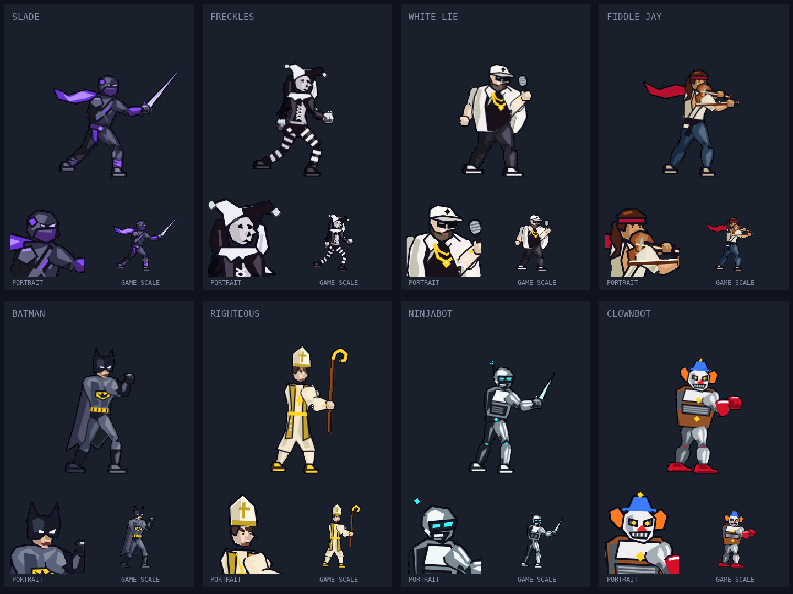

# Character art overhaul

Eight independent art-critic rounds completed. Final score: **8.1/10**, up from **3.4/10**. The requested eight-round cap was reached before the 9/10 target.

## What changed

All six fighters and both robot enemies now use newly authored Canvas character art: distinct silhouettes, sculpted limbs, clearer faces, shaped hands and boots, material-specific shading, and character-specific costume details. Weapon grips and the fiddle were rebuilt. Alternate and boss palettes remain supported.

Grounded stances, hip transfer, anticipation, torso rotation and trailing cloth improve the animation poses. Combat timings, damage and hitboxes are unchanged. Characters and portraits now render at native resolution above the existing lower-resolution scenery; finer sprite color quantization preserves dark costumes and skin tones.

## Critique history

| Round | Score | Main work |
| --- | --- | --- |
| Baseline | 3.4 | Original artwork |
| 1 | 6.3 | Full painter and anatomy replacement |
| 2 | 7.0 | Native-resolution sprites and weapon corrections |
| 3 | 7.4 | Joint seams, materials and missing limbs |
| 4 | 7.5 | Costume masses and fiddle geometry |
| 5 | 7.7 | Stances, gait, proportions and stocking simplification |
| 6 | 7.9 | Contact weight, boss palettes and instrument readability |
| 7 | 8.0 | Anticipation, torso turn, grips and cloth |
| 8 | 8.1 | Dark material planes and facial expressions |

Final critic breakdown: anatomy 8.0, materials 8.0, faces 7.7, distinction 8.3, gameplay readability 8.4, animation poses 7.9. The remaining gap is shared procedural anatomy, restrained human expressions and insufficiently exaggerated attack silhouettes. This is improved stylized arcade art, not a claim of AAA production quality. Static critique scores do not establish playback polish.

## Previews

[Before](character-art/before.png) · [After](character-art/after.png) · [Pose sheet](character-art/poses.png) · [Costumes](character-art/costumes.png) · [Character select](character-art/character-select.png) · [Gameplay](character-art/gameplay.png) · [Combat playback](character-art/combat-preview.mp4)

## Verification

- `npm run build` passes.
- `npm run verify:art` passes: 6,662 pose/render samples across eight characters, real variants, both facings, states and moves; 3,280 finite weapon attachment checks; zero browser errors.
- Character selection and four gameplay configurations were captured, including alternate and boss palettes.
- Nine seconds of deterministic combat playback was captured across three fighter pairs.
- `git diff --check` passes.

Verification uses a headless software browser, with gamepad polling disabled only in the test harness. Physical mobile performance and controller hardware were not validated. The higher-resolution sprite pass increases rendering work; the edge pass is bounded to occupied pixels. See the app README for reproducible verification commands.
